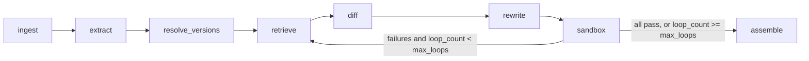

# Tutorial Rot Fixer

A multi-agent system that takes an outdated Python tutorial (Markdown containing Python code) and
produces an updated version whose code **actually runs against current library versions**.
Verification by execution is the core of the project: nothing is reported as passing unless it ran
in a sandbox.

v1 scope: Python tutorials, Pydantic v1 → v2 and pandas 1.x → 2.x (pluggable via `LibraryConfig`).
Input: a Markdown file. Output: updated Markdown plus a change log (what changed, why, source
links, run status per code block).

**Status:** Phases 0–2 complete, Phase 3 (diff/rewrite/assemble + eval dataset) in progress. See
[Status](#status) for exactly what exists and what the numbers do and do not show.
Setup instructions are in [SETUP.md](SETUP.md).

## How it works



`graph.py` is a LangGraph `StateGraph` with a conditional cycle. Every node is a pure-ish function
(`GraphState` in, state patch out), typed with Pydantic, and unit-testable with a mocked LLM.

| Node | What it does |
|---|---|
| `ingest` | Lossless Markdown split into prose and code segments (re-rendering gives back the exact input), language detection, tutorial date inference, version pins from `pip install` lines |
| `extract` | AST analysis: libraries, imported/used symbols (`pandas.DataFrame.append`, `pydantic.Field(regex)`, `...Config.orm_mode`), install commands, extra third-party packages |
| `resolve_versions` | Old version from exact pin, then range pin, then tutorial date (never guessed); target = latest PyPI release within the migration's target major, or a user pin |
| `retrieve` | Per-symbol retrieval over the corpus (see below) |
| `diff` | One batched LLM call per library classifies symbols `unchanged / renamed / signature_changed / removed / behavior_changed`; every verdict must cite chunk ids actually shown to the model |
| `rewrite` | Surgical per-block LLM edits (prose is never touched); output must parse and every change must map to a cited verdict. Deterministic edits for install pins and newly required packages |
| `sandbox` | Builds a cached image with the exact target versions, then runs all blocks in one network-less container with per-block status, traceback, stdout and assertions |
| `assemble` | Final Markdown + change log. Blocks still failing become `unresolved` with their last error; never reported as passing |

### Retrieval

Corpus per library from raw Markdown/RST on GitHub (migration guides, changelogs / whatsnew, docs),
chunked by section with heading path and `version_introduced` metadata. Stages, each behind a flag
in `PipelineFlags` so the eval can ablate them:

```
symbol index ─┐
BM25 ─────────┼─ RRF ─ version filter ─ cross-encoder (blended with fused score) ─ version boost ─ top-k
dense ────────┘
```

BM25 uses an identifier-aware tokenizer (`parse_obj`, `DataFrame.append` stay whole); dense uses
`BAAI/bge-small-en-v1.5` with a numpy store; reranking uses `ms-marco-MiniLM-L-6-v2`; the
symbol index maps each symbol to the changelog entries that mention it.

### Sandbox

All generated code runs only in Docker: dependencies are installed at image build time, then every
run uses `--network none`, a read-only filesystem, dropped capabilities and CPU/memory/pid/time
limits. Blocks execute in one shared namespace (tutorials are cumulative) through a driver that
`exec`s each block separately, so each gets its own result even after an earlier failure. Optional
per-block assertions (expected stdout substrings, or a snippet run in the tutorial's namespace)
make "runs without error" not the only pass criterion.

### Evidence discipline

- `DiffVerdict` and `ChangeLogEntry` reject uncited claims at the model level.
- A verdict citing ids that were never retrieved is dropped, not kept.
- `llm_prior` change entries exist only for the no-retrieval baseline and are labelled "uncited".
- A rewritten block with no attributable citation is rejected and the original kept.

## Repository layout

```
.
  pyproject.toml, uv.lock, README.md, SETUP.md
  src/trf/
    config.py        env settings, PipelineFlags, LibraryConfig registry
    llm.py           provider-agnostic wrapper (anthropic / openai-compatible / ollama), structured output, disk cache
    state.py         Pydantic models + GraphState
    graph.py         LangGraph wiring
    pypi.py          release metadata for version resolution
    nodes/           ingest, extract, resolve_versions, retrieve, diff, rewrite, sandbox, assemble
    rag/             corpus, chunking, bm25, dense, hybrid (RRF), rerank, symbol_index, pipeline
    sandbox_runner/  Dockerfile + in-container runner
    eval/            dataset/ (15 tutorials), loader, baseline, validate_dataset, metrics, run_eval
    api/             FastAPI (Phase 5)
  scripts/           retrieval_sanity.py
  tests/
```

## Status

| Phase | Content | State |
|---|---|---|
| 0 | Scaffold, config, LLM wrapper, state, graph with conditional cycle, sandbox image + smoke test | done |
| 1 | ingest / extract / resolve_versions / sandbox, baseline on 3 tutorials | done |
| 2 | Corpus, BM25, dense, RRF, rerank, symbol index, retrieval sanity script | done |
| 3 | diff, rewrite, assemble (implemented and unit-tested); 15-tutorial eval dataset with hand-fixed references; eval on configs 1–4 | in progress |
| 4 | Sandbox feedback loop (`query_rewrite`), unresolved handling, full ablation | not started |
| 5 | FastAPI + side-by-side diff UI | not started |
| 6 | Polish: ablation results, limitations, demo script | not started |

### Evaluation dataset

`src/trf/eval/dataset/` holds 15 hand-built tutorials (6 Pydantic v1→v2, 8 pandas 1.x→2.x, 1 mixed).
Each has four files:

| file | content |
|---|---|
| `NAME.md` | the outdated tutorial (valid in its original pinned environment) |
| `NAME.fixed.md` | hand-fixed reference: identical prose, only code differs, passes in the target env |
| `NAME.assertions.json` | per-block expected stdout / snippet, so "runs without error" is not the only criterion |
| `NAME.symbols.json` | hand-labelled verdicts for the symbols that changed (84 in total) |

`uv run python -m trf.eval.validate_dataset` proves the dataset is sound: every original must pass
in its original environment (Python 3.10, pinned versions) and every reference must pass in the target
environment (Python 3.12, pandas 2.3.3 / pydantic 2.13.5), with identical prose and block structure.
All 15 pass both checks. Verdict labels: `renamed` (same thing, new name), `signature_changed`
(argument / keyword / config key), `removed`, `behavior_changed` (same API, different semantics).

### Eval configs and metrics

`uv run python -m trf.eval.run_eval` (resumable; logs every run as JSON under `runs/eval/`):

| config | meaning |
|---|---|
| `0_original` | untouched tutorial in the target env (how broken is it?) |
| `1_llm_only` | LLM rewrites each block from its own knowledge: no retrieval, no verdicts |
| `2_dense` | + dense retrieval, cited diff verdicts |
| `3_hybrid` | + BM25 fused with RRF |
| `4_full` | + cross-encoder rerank, version boost, symbol index |
| `5_loop` | + sandbox feedback loop (Phase 4) |

Metrics (`trf/eval/metrics.py`): block and tutorial **pass rate** (primary; assertions included),
symbol-level **diff accuracy** against the hand labels, **minimal-edit** ratio (original lines the
system changed that the reference did not, plus prose segments altered), and **unresolved rate**.
Note that a tutorial can pass without being modernised (Pydantic v2 still runs the deprecated
`@validator`), which is why pass rate alone is not the whole story.

### Phase 1 baseline: how broken are the original tutorials?

`uv run python -m trf.eval.baseline [--mode target|old]` runs each tutorial's ORIGINAL code in a
Docker env with exact pinned versions and logs per-block results.

| case | python blocks | pass (target: pandas 2.3.3 / pydantic 2.13.5) | pass (control: original pins) |
|---|---|---|---|
| pydantic_user_models | 5 | 0 | 5 |
| pandas_sales_analysis | 6 | 1 | 6 |
| mixed_settings_and_frames | 5 | 0 | 5 |

The control column shows the tutorials are valid in their original environments (Python 3.10), so
every target-environment failure is genuine version rot.

### Phase 2 retrieval smoke test

`scripts/retrieval_sanity.py`, 10 known symbols, a hit = a top-5 chunk mentions both the old symbol
and its replacement:

| config | hit@5 | MRR@5 |
|---|---|---|
| BM25 only | 10/10 | 0.87 |
| dense only | 7/10 | 0.53 |
| hybrid RRF | 9/10 | 0.62 |
| + rerank | 9/10 | 0.78 |
| + rerank + version boost | 9/10 | 0.80 |
| + symbol index (full) | 10/10 | 0.90 |

Caveats: 10 cases, and the rerank blend weight (0.5) was tuned on the same cases, so this is a smoke
test, not a result. BM25 alone is a strong baseline on identifier queries; the full pipeline's edge
over it is small here. The end-to-end pass rate in the Phase 3/4 eval is the real comparison.

## Known limitations

- Fenced blocks indented more than three spaces (e.g. inside list items) are treated as prose.
- Method-call symbol extraction uses a light, flow-insensitive type tracker, not real type inference.
- Blocks share one namespace, so a failing early block can make later blocks fail too; those are
  tagged "may be a downstream effect" in `last_error`, which is a hint, not a diagnosis.
- Prose is never edited, so prose that mentions old versions or APIs stays as written.
- Install-block updates are deterministic and only handle simple `pip install` lines.
- With a reasoning model on a small local GPU each LLM call takes tens of seconds; the diff stage is
  batched per library for this reason.
