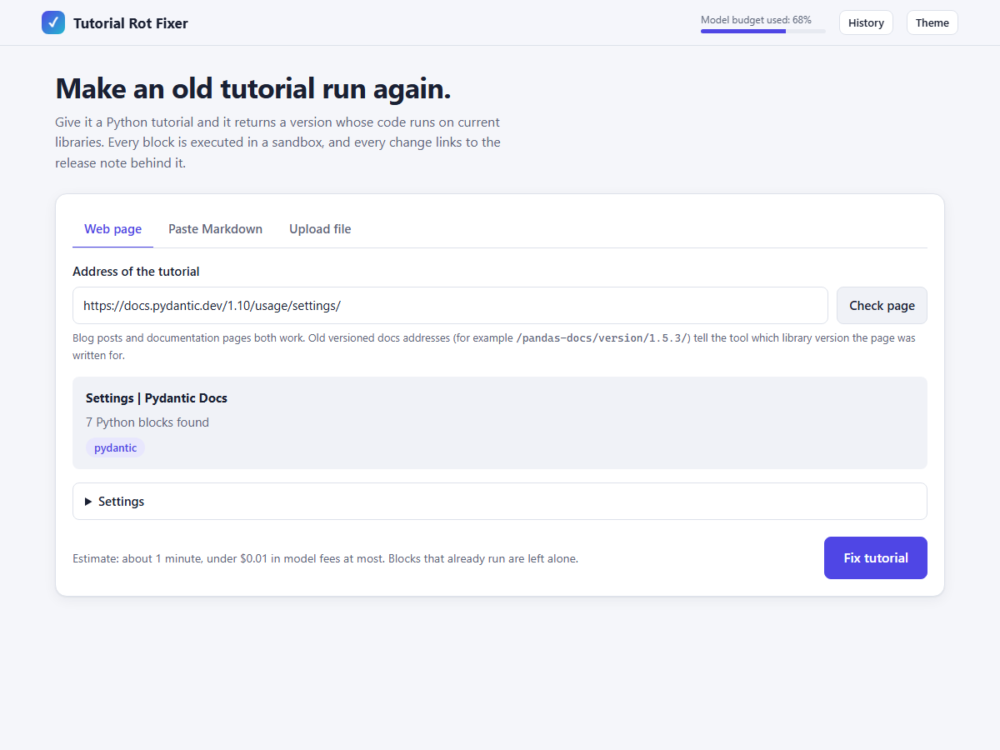
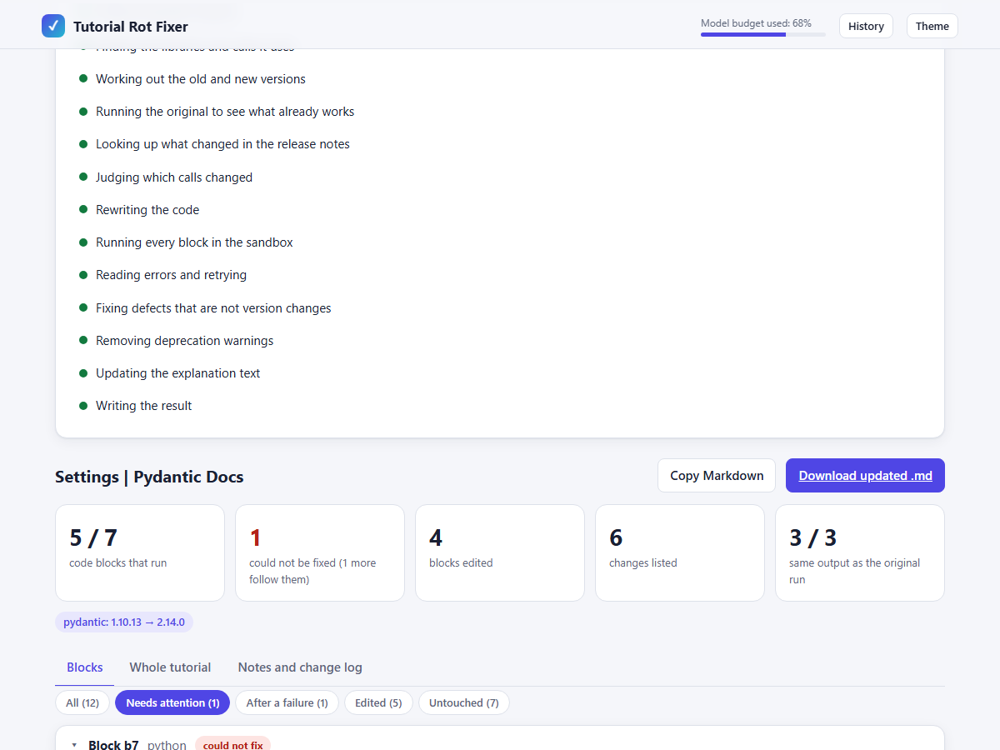
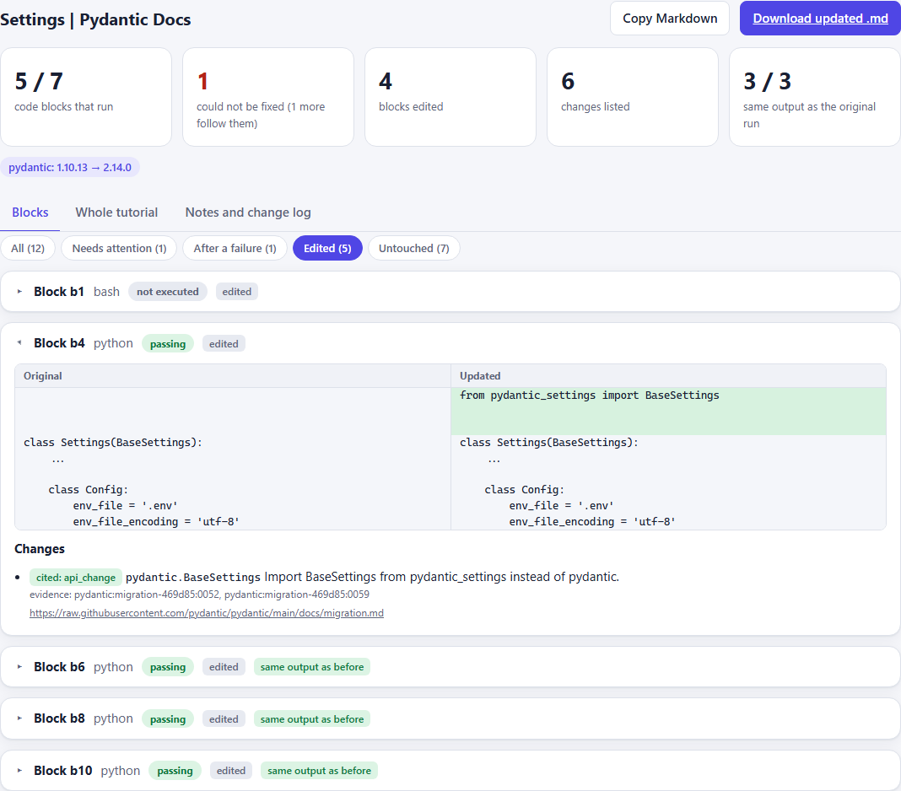

# Tutorial Rot Fixer

[](https://github.com/thorOdinson16/tutorial-fixer/actions/workflows/ci.yml)

Old Python tutorials rot: the library changed and the code no longer runs. This tool takes a
tutorial (Markdown with Python code) and returns an updated version whose code **actually runs
against current library versions**. Nothing is reported as passing unless it ran in a sandbox, and
every change is listed with the release note that justifies it.

```text
before   df = df.append({'a': 2}, ignore_index=True)        AttributeError on pandas 2.x
after    df = pd.concat([df, pd.DataFrame([{'a': 2}])], ignore_index=True)

change log   [api_change] pandas.DataFrame.append: replaced the removed append with concat
             evidence: pandas:v1-4-0:0035  https://raw.githubusercontent.com/pandas-dev/...
             block b3: passing    output identical to the original run on pandas 1.3.5
```

## The web page

Paste a tutorial, give a web address, or upload a file; see what it found and an estimate before
anything runs; watch each stage; then read every block's diff with the release note behind it.

| 1. Give it a page | 2. Watch it work | 3. Read the result |
|---|---|---|
|  |  |  |

(Real run: pydantic's v1.10 *Settings* page. 5 of 7 blocks run on pydantic 2.14; the other two
depend on an environment variable the page never sets.)

## What it does

- **Fixes version rot** for seven libraries: pandas 1.x to 2.x, pydantic v1 to v2, NumPy 1.x to 2.x,
  SQLAlchemy 1.x to 2.x, scikit-learn 0.x to 1.x, Matplotlib 2.x/3.x to the latest, SciPy 1.x to the latest.
  Retrieval over each project's own release notes (plus deprecations mined from its source) finds what changed, an LLM makes minimal edits,
  and a Docker sandbox runs every block (no network, read-only filesystem except a scratch dir).
- **Reads `>>>` sessions** (pasted interpreter transcripts) as code, with the output lines kept.
- **Verifies by execution**, and loops: a block that still fails is analysed from its traceback and
  retried with evidence for the symbol that broke.
- **Opt-in extras** (on by default in the demo and the web service): leave blocks that already run
  alone, repair defects that are not version rot (forgotten imports and packages), keep the
  explanation text in step with the code, and fix code that runs but emits deprecation warnings.
- **Explains what it could not fix**, per block, in plain words ("uses `List` but nothing imports
  it", "needs a database"), and never reports an unresolved block as passing.

## Quickstart

```bash
git clone https://github.com/thorOdinson16/tutorial-fixer.git && cd tutorial-fixer
uv sync --extra rag --extra api
# put TRF_LLM_PROVIDER, TRF_LLM_MODEL, TRF_LLM_API_KEY in .env, start Docker, then:
uv run trf-serve                                   # web UI: give a URL or paste Markdown, see diffs
uv run python scripts/demo.py path/to/tutorial.md  # or the command line
```

Full setup (Docker, corpus, model options, spend cap): [SETUP.md](SETUP.md).

## How well does it work

Model `gpt-6-luna`, one run per configuration, so small differences are noise.

| | blocks that run, untouched | after the pipeline |
|---|---|---|
| 33 evaluation tutorials (hand-built, validated) | 36% | **93%** (LLM-only baseline: 92%) |
| 20 real web tutorials (624 blocks) | 75% | **89%** |
| 17 pages of the projects' own docs (654 blocks) | 53% | **71%** |

The pipeline ties a no-retrieval LLM baseline on pass rate; what retrieval adds is **cited,
verifiable edits**, and the sandbox loop is what lifts retrieval-only variants from 80% to 93%.
Most blocks that stay broken on real pages are not version rot but incomplete tutorials (a missing
project module, a data file, a database). The numbers and their caveats are in
[docs/results.md](docs/results.md) and [docs/real-tutorials.md](docs/real-tutorials.md).

## Documentation

| | |
|---|---|
| [SETUP.md](SETUP.md) | install, Docker, corpus, model configuration, troubleshooting |
| [docs/how-it-works.md](docs/how-it-works.md) | the pipeline, retrieval, sandbox, evidence rules, repository layout |
| [docs/modes.md](docs/modes.md) | protect working blocks, defect repair, prose updates, warning fixes |
| [docs/results.md](docs/results.md) | every evaluation number and caveat |
| [docs/real-tutorials.md](docs/real-tutorials.md) | runs on real web pages and official docs |
| [docs/evaluation.md](docs/evaluation.md) | datasets, configs, metrics, how to reproduce |
| [docs/adding-a-library.md](docs/adding-a-library.md) | add another library |
| [docs/spend-cap.md](docs/spend-cap.md) | the hard LLM budget |
| [docs/limitations.md](docs/limitations.md) | what it does not do |

## Status

Complete and evaluated; 298 tests. Python tutorials only. Every number above is reproducible with
the commands in [docs/evaluation.md](docs/evaluation.md), and the limits are stated in
[docs/limitations.md](docs/limitations.md).
