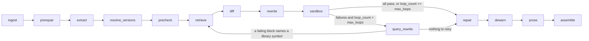

# Tutorial Rot Fixer

A multi-agent system that takes an outdated Python tutorial (Markdown containing Python code) and
produces an updated version whose code **actually runs against current library versions**.
Verification by execution is the core of the project: nothing is reported as passing unless it ran
in a sandbox.

Scope: Python tutorials and six libraries, each with its own release-note corpus: **pandas** 1.x → 2.x,
**pydantic** v1 → v2, **NumPy** 1.x → 2.x, **SQLAlchemy** 1.x → 2.x, **scikit-learn** 0.x → 1.x and
**Matplotlib** 2.x/3.x → latest 3.x. Libraries are pluggable: see [Adding a library](#adding-a-library).
Beyond version fixes it can also repair defects that are not version rot (forgotten imports and
packages), keep the explanation text in step with the code, and fix code that still runs but emits
deprecation warnings; see [Beyond version fixes](#beyond-version-fixes).
Input: a Markdown file. Output: updated Markdown plus a change log (what changed, why, source
links, run status per code block).

**Status:** complete and evaluated. The pipeline, feedback loop, six-library corpora, eval harness
and web UI are built and tested (229 tests, a mocked LLM and sandbox where needed). On 33 evaluation
tutorials the full pipeline runs 93% of code blocks (36% untouched); on 20 real tutorials 87% (75%
untouched). See [Results](#results) for the numbers and, as importantly, what they do not show.
Setup instructions are in [SETUP.md](SETUP.md).

## How it works



`prerepair`, `precheck`, `repair`, `dewarn` and `prose` are opt-in stages (no-ops unless their flag
is on).

`graph.py` is a LangGraph `StateGraph` with a conditional cycle. Every node is a pure-ish function
(`GraphState` in, state patch out), typed with Pydantic, and unit-testable with a mocked LLM.

| Node | What it does |
|---|---|
| `ingest` | Lossless Markdown split into prose and code segments (re-rendering gives back the exact input), language detection, tutorial date inference, version pins from `pip install` lines |
| `extract` | AST analysis: libraries, imported/used symbols (`pandas.DataFrame.append`, `pydantic.Field(regex)`, `...Config.orm_mode`), install commands, extra third-party packages |
| `prerepair` | Opt-in. Adds imports a tutorial forgot (`np`, `pd`, `plt`, `List`, ...) before symbols are extracted, found by static analysis |
| `resolve_versions` | Old version from exact pin, then range pin, then tutorial date (never guessed); target = latest PyPI release within the migration's target major, or a user pin |
| `precheck` | Opt-in (`protect_working_blocks`). Runs the ORIGINAL tutorial in its target and old environments; blocks that already run (with unchanged output) are never edited |
| `retrieve` | Per-symbol retrieval over the corpus (see below); in loop passes it also queries with the observed error message |
| `diff` | One batched LLM call per library classifies symbols `unchanged / renamed / signature_changed / removed / behavior_changed`; every verdict must cite chunk ids actually shown to the model |
| `rewrite` | Surgical per-block LLM edits (prose is untouched unless `update_prose` is on); output must parse and every change must map to a cited verdict. Deterministic edits for install pins and newly required packages |
| `sandbox` | Builds a cached image with the exact target versions, then runs all blocks in one network-less container with per-block status, traceback, stdout and assertions |
| `query_rewrite` | Loop only: reads each failing block's traceback and names the library symbol that broke (`'DataFrame' object has no attribute 'append'` -> `pandas.DataFrame.append`, `unexpected keyword argument 'squeeze'` -> `pandas.read_csv(squeeze)`). Deterministic pattern matching, no LLM call. Only symbols still lacking evidence or a verdict are retrieved and diffed again; the diff prompt gets the observed failure. If no symbol can be named the block stays failing and ends `unresolved` |
| `repair` | Opt-in (`repair_defects`). Fixes missing packages and other defects that are not version rot, verifying each fix in the sandbox and reverting the ones that do not remove their error; drafts suggestions for undefined names |
| `dewarn` | Opt-in (`fix_warnings`). Treats a block that runs but emits a deprecation warning as a soft failure and sends it through retrieve, diff and rewrite; keeps the edit only if the block still runs with identical output, the warning is gone and no other block regressed |
| `prose` | Opt-in (`update_prose`). Sentence-level, guarded edits of text that mentions changed APIs or old versions (see Beyond version fixes) |
| `assemble` | Final Markdown + change log. Blocks still failing become `unresolved` with their last error; never reported as passing |

### Retrieval

Corpus per library from raw Markdown/RST on GitHub (migration guides, changelogs / whatsnew, docs),
chunked by section with heading path and `version_introduced` metadata. Stages, each behind a flag
in `PipelineFlags` so the eval can ablate them:

```
symbol index ─┐
BM25 ─────────┼─ RRF ─ version filter ─ cross-encoder (blended with fused score) ─ version boost ─ top-k
dense ────────┘
```

BM25 uses an identifier-aware tokenizer (`parse_obj`, `DataFrame.append` stay whole); dense uses
`BAAI/bge-small-en-v1.5` with a numpy store; reranking uses `ms-marco-MiniLM-L-6-v2`; the
symbol index maps each symbol to the changelog entries that mention it.

### Sandbox

All generated code runs only in Docker: dependencies are installed at image build time, then every
run uses `--network none`, a read-only filesystem, dropped capabilities and CPU/memory/pid/time
limits. Blocks execute in one shared namespace (tutorials are cumulative) through a driver that
`exec`s each block separately, so each gets its own result even after an earlier failure. Optional
per-block assertions (expected stdout substrings, or a snippet run in the tutorial's namespace)
make "runs without error" not the only pass criterion.

### Evidence discipline

- `DiffVerdict` and `ChangeLogEntry` reject uncited claims at the model level.
- A verdict citing ids that were never retrieved is dropped, not kept.
- `llm_prior` change entries exist only for the no-retrieval baseline and are labelled "uncited".
- A rewritten block with no attributable citation is rejected and the original kept.

## Repository layout

```
.
  pyproject.toml, uv.lock, README.md, SETUP.md
  src/trf/
    config.py        env settings, PipelineFlags, LibraryConfig registry
    llm.py           provider-agnostic wrapper (anthropic / openai-compatible / ollama), structured output, disk cache
    state.py         Pydantic models + GraphState
    graph.py         LangGraph wiring
    pypi.py          release metadata for version resolution
    nodes/           ingest, prerepair, extract, resolve_versions, precheck, retrieve, diff, rewrite,
                     sandbox, query_rewrite, repair, dewarn, prose, diagnose, assemble
    rag/             corpus, chunking, bm25, dense, hybrid (RRF), rerank, symbol_index, pipeline
    sandbox_runner/  Dockerfile + in-container runner
    eval/            dataset/ (15), dataset_heldout/ (6), dataset_libs/ (12), dataset_prose/ (9),
                     dataset_defects/ (12, generated), loader, baseline, validate_dataset, prose_check,
                     metrics, run_eval
    api/             FastAPI service + static/index.html (single-file UI)
  scripts/           retrieval_sanity.py, demo.py, check_case.py, oracle_check.py, make_defect_set.py
  tests/
```

## Status

| Phase | Content | State |
|---|---|---|
| 0 | Scaffold, config, LLM wrapper, state, graph with conditional cycle, sandbox image + smoke test | done |
| 1 | ingest / extract / resolve_versions / sandbox, baseline on 3 tutorials | done |
| 2 | Corpus, BM25, dense, RRF, rerank, symbol index, retrieval sanity script | done |
| 3 | diff, rewrite, assemble (implemented and unit-tested); 15-tutorial eval dataset with hand-fixed references; eval runner | done; evaluated (see Results) |
| 4 | Sandbox feedback loop (`query_rewrite`) and unresolved handling: implemented and tested with a scripted LLM and sandbox; full ablation needs a real model | done; evaluated as config `5_loop` |
| 5 | FastAPI service + side-by-side diff UI (`trf.api.main`), tested with a fake runner and checked in headless Chrome | done |
| 6 | Polish: demo script, limitations, ablation, results | done (single-run results, see caveats) |
| 7 | Six libraries (NumPy, SQLAlchemy, scikit-learn, Matplotlib added), held-out and library eval sets, `protect_working_blocks`, plain-language diagnoses, `trf-serve`, spend cap | done |
| 8 | Defect repair (static import pre-repair, verified import/package repairs, suggested definitions), guarded prose updates and deprecation-warning fixes, with defect and prose eval sets | done (see Results) |

### Evaluation dataset

`src/trf/eval/dataset/` holds 15 hand-built tutorials (6 Pydantic v1→v2, 8 pandas 1.x→2.x, 1 mixed);
`dataset_heldout/` 6 more written afterwards, and `dataset_libs/` 12 for NumPy, SQLAlchemy,
scikit-learn and Matplotlib (3 each). Each has four files:

| file | content |
|---|---|
| `NAME.md` | the outdated tutorial (valid in its original pinned environment) |
| `NAME.fixed.md` | hand-fixed reference: identical prose, only code differs, passes in the target env |
| `NAME.assertions.json` | per-block expected stdout / snippet, so "runs without error" is not the only criterion |
| `NAME.symbols.json` | hand-labelled verdicts for the symbols that changed (84 in total) |

`uv run python -m trf.eval.validate_dataset` proves the dataset is sound: every original must pass
in its original environment (Python 3.10, pinned versions) and every reference must pass in the target
environment (Python 3.12, pandas 2.3.3 / pydantic 2.13.5), with identical prose and block structure.
All 33 pass both checks (`--dataset-dir` selects a set). Verdict labels: `renamed` (same thing, new name), `signature_changed`
(argument / keyword / config key), `removed`, `behavior_changed` (same API, different semantics).

### Eval configs and metrics

`uv run python -m trf.eval.run_eval` (resumable; logs every run as JSON under `runs/eval/`):

| config | meaning |
|---|---|
| `0_original` | untouched tutorial in the target env (how broken is it?) |
| `1_llm_only` | LLM rewrites each block from its own knowledge: no retrieval, no verdicts |
| `2_dense` | + dense retrieval, cited diff verdicts |
| `3_hybrid` | + BM25 fused with RRF |
| `4_full` | + cross-encoder rerank, version boost, symbol index |
| `5_loop` | + sandbox feedback loop (Phase 4) |
| `6_protect` | `5_loop` + never edit a block that already runs (opt-in) |
| `7_repair` | `6_protect` + defect repair (forgotten imports and packages) |
| `8_prose` | `6_protect` + prose updates |
| `9_all` | `6_protect` + repair + prose |
| `10_warnings` | `6_protect` + warning fixes |
| `11_everything` | `6_protect` + repair + prose + warning fixes |

Metrics (`trf/eval/metrics.py`): block and tutorial **pass rate** (primary; assertions included),
symbol-level **diff accuracy** against the hand labels, **minimal-edit** ratio (original lines the
system changed that the reference did not, plus prose segments altered), and **unresolved rate**.
Note that a tutorial can pass without being modernised (Pydantic v2 still runs the deprecated
`@validator`), which is why pass rate alone is not the whole story.

### Phase 1 baseline: how broken are the original tutorials?

`uv run python -m trf.eval.baseline [--mode target|old]` runs each tutorial's ORIGINAL code in a
Docker env with exact pinned versions and logs per-block results.

| case | python blocks | pass (target: pandas 2.3.3 / pydantic 2.13.5) | pass (control: original pins) |
|---|---|---|---|
| pydantic_user_models | 5 | 0 | 5 |
| pandas_sales_analysis | 6 | 1 | 6 |
| mixed_settings_and_frames | 5 | 0 | 5 |

The control column shows the tutorials are valid in their original environments (Python 3.10), so
every target-environment failure is genuine version rot.

### Phase 2 retrieval smoke test

`scripts/retrieval_sanity.py`, 10 known symbols, a hit = a top-5 chunk mentions both the old symbol
and its replacement:

| config | hit@5 | MRR@5 |
|---|---|---|
| BM25 only | 10/10 | 0.87 |
| dense only | 7/10 | 0.53 |
| hybrid RRF | 9/10 | 0.62 |
| + rerank | 9/10 | 0.78 |
| + rerank + version boost | 9/10 | 0.80 |
| + symbol index (full) | 10/10 | 0.90 |

Caveats: 10 cases, and the rerank blend weight (0.5) was tuned on the same cases, so this is a smoke
test, not a result. BM25 alone is a strong baseline on identifier queries; the full pipeline's edge
over it is small here. The end-to-end pass rate in the Phase 3/4 eval is the real comparison.

## Running it

```bash
uv sync --extra rag --extra api
# put TRF_LLM_PROVIDER / TRF_LLM_MODEL / TRF_LLM_API_KEY in .env (see SETUP.md)
uv run trf-serve                       # checks Docker + model + corpora, builds what is missing,
                                       # starts the service and opens the UI on :8000
uv run python scripts/demo.py pandas_sales_analysis   # or: one tutorial from the command line
```

`scripts/demo.py` and the service leave blocks that already run untouched by default (the
`protect_working_blocks` precheck, described in Results); `--no-protect` switches that off.

The UI (`/`) takes pasted or uploaded Markdown and shows, per code block, the original and updated
code side by side, a status badge, the error of any unresolved block, and every change with its
cited source links (uncited `llm_prior` edits are labelled as such). API: `POST /api/jobs`,
`GET /api/jobs/{id}`, `GET /api/jobs/{id}/download`. Jobs are held in memory and run one at a time.

## Beyond version fixes

Two opt-in modes on top of the version fixing (`PipelineFlags.repair_defects`, `update_prose`; on by
default in `scripts/demo.py` and the web service, off in the eval configs `1`-`6`).

**Defect repair** targets blocks that fail for reasons other than library versions.

| defect | what happens |
|---|---|
| a well-known name is used but never imported (`np`, `pd`, `plt`, `List`, ...) | `prerepair` finds it statically, right after ingest, and adds the import at the top of the first block that uses it. This has to come first: with `import pandas as pd` missing the analyzer sees no `pd.` calls, so no version fix would even be attempted |
| a missing package (`ModuleNotFoundError`, "Missing optional dependency") | `repair` adds it to the install line and the environment |
| a name nothing defines (`Alice`) | the LLM drafts a 1-4 line definition; it is only a **suggestion** in the change log unless `apply_placeholders` is on, when it is inserted with a `# added by TRF (assumed): ...` comment |
| a project-local module, a data file, a database, the network, an intentional error | not repairable: reported with a plain-language reason |

Every repair of a runtime error is verified by re-running the sandbox and **reverted** unless the
error it targeted is gone. Each repair is a `defect_fix` change-log entry that quotes the error it
removed (there is no release note to cite). A block that already runs is never touched.

**Prose updates** were never allowed before; they are now, under strict rules:

- only sentences that mention a library version or an API the code edits really changed (or a name
  the edits removed) are even shown to the model; a tutorial with nothing to fix costs no call;
- the model returns replacements for individual sentences, never a rewritten document;
- every replacement is validated: it must stay close to the original (similarity and length), keep
  links and backticks intact, introduce no number that is not a target version or part of the new
  code, and match exactly one place in the prose;
- edits are applied by exact string replacement, so headings, links, code fences and every
  untouched sentence stay byte-for-byte identical;
- each applied edit is listed in the change log and the UI with its reason and the symbol or
  version that justified it.

**Warning fixes** (`fix_warnings`) cover code that still runs but warns. The sandbox records every
warning a block emits (category, message, line). A deprecation warning is tied to the library
symbol the block really uses (`applymap` in "DataFrame.applymap has been deprecated"), and the block
is then treated as a soft failure: release notes are retrieved for that symbol (with the warning text
as a second query), diffed and rewritten like any other fix, so every edit is cited. The edit is
kept only if, in a verification run, (a) the block still runs, (b) it prints exactly what it printed
before, (c) that warning is gone, and (d) no other block regressed; otherwise the whole batch is
reverted. A block that runs but warns is not "protected" while this mode is on.

Security-flavoured warnings (insecure or unverified requests, certificates) are listed first in the
change log's "Warnings still emitted" section and are changed only if a cited fix verifies the same
way; the tool never guesses at a security fix. Deprecation warnings it cannot tie to a symbol are
reported, not touched.

## Results

Model `gpt-6-luna` via the OpenAI API, temperature 0, Docker sandbox, max 4 loops, one run per
configuration. A block passes only if it ran in the target environment and met its assertions.
Three evaluation sets, 33 tutorials in all (181 python blocks):

| set | tutorials | libraries | how it was made |
|---|---|---|---|
| dev | 15 | pandas, pydantic | hand-written; used while building the system |
| held-out | 6 | pandas, pydantic | written later around APIs the dev set does not use |
| libs | 12 | NumPy, SQLAlchemy, scikit-learn, Matplotlib (3 each) | written by subagents from a spec |

Every tutorial is validated in Docker (`validate_dataset --dataset-dir ...`): the original passes in
its old environment, the hand-fixed reference passes in the target one, and several blocks of the
original really break there.

**Block pass rate / tutorials fully passing**

| config | dev (15) | held-out (6) | libs (12) | all 33 |
|---|---|---|---|---|
| `0_original` (untouched) | 41% / 1 | 29% / 0 | 32% / 0 | 36% / 1 |
| `1_llm_only` (no retrieval) | 87% / 7 | 97% / 5 | 97% / 10 | 92% / 22 |
| `2_dense` | 67% / 4 | 76% / 0 | 63% / 1 | 67% / 5 |
| `3_hybrid` | 71% / 5 | 82% / 2 | 71% / 3 | 73% / 10 |
| `4_full` | 77% / 5 | 94% / 4 | 77% / 6 | 80% / 15 |
| `5_loop` (+ sandbox loop) | 88% / 8 | 97% / 5 | 98% / 11 | 93% / 24 |
| `6_protect` (+ keep working blocks) | 88% / 8 | 97% / 5 | 98% / 11 | 93% / 24 |

Reading it:

- **The pipeline fixes most of the rot**: 36% of blocks run untouched, 93% after `5_loop`.
- **Every retrieval stage helps, and the loop helps most.** Dense < hybrid < full < loop on all three
  sets. Without the loop, a block is edited only when a cited verdict covers it, so a missed verdict
  leaves it broken (80% for `4_full`); the loop finds the symbol from the sandbox error, retrieves
  with the error message, and closes the gap.
- **`5_loop` ties the no-retrieval baseline on pass rate** (93% vs 92%, 24 vs 22 tutorials fully
  passing), within noise at this sample size. What retrieval adds is **cited, auditable edits**
  (each change links to the release note that justifies it, `1_llm_only` edits are labelled uncited)
  and changed-symbol recall of 88-100%.
- **`6_protect` leaves pass rate unchanged and makes ~12% fewer edits** (169 change-log entries vs
  192) and ~1.3 fewer LLM calls per tutorial, because it never edits a block that already runs.
- **Per library (libs set, blocks passing):** NumPy 15/15, scikit-learn 16/16, Matplotlib 18/18,
  SQLAlchemy 15/16 for `5_loop`, against 14/15, 16/16, 17/18 and 16/16 for `1_llm_only`. Diff
  accuracy is the weakest metric (57-61%); most misses are behaviour changes with no error.

**Caveats.** One model, one run per config. A block is about 0.5% of the pooled pass rate, so
differences of a point or two are noise. The dev and libs sets were used to find and fix problems
(below), so their numbers are optimistic; the held-out set was written after the system was tuned
and was re-run after every later change (97% throughout), which is the cleaner check. The libs and
held-out tutorials were written by smaller models from a spec, so they are cleaner and shorter than
real tutorials.

### What running the real model taught us (all fixed, with tests)

OpenAI's newer models need `max_completion_tokens`; the diff dropped every verdict whose symbol the
model echoed as `name (kind)`; evidence was clipped before the key sentence; a model adding
`engine="pyarrow"` to working code; a block broken by the system's own edit was not retried; a
correct edit was dropped as "unattributed" when the model named no symbol (it is now attributed to
the verdicts whose symbols appear in the lines it changed); retrieval never found `np.float`
because notes say `np`, not `numpy` (aliases `np`/`pd`/`plt` are now searched); errors that name no
function (`tuple indices must be integers... not str` is SQLAlchemy 2 Row access) now map to the API
behind them; a bad argument value (`'seaborn-white' is not a valid style`) is traced to the call
that received it; a symbol that still fails after its verdict was applied is re-retrieved with the
error message as a query, and those chunks go first because the diff stage only shows the top few.

### Protecting blocks that already work (`6_protect`)

Opt-in (`PipelineFlags.protect_working_blocks`, config `6_protect`, on by default in
`scripts/demo.py` and the web service). A `precheck` stage runs the ORIGINAL tutorial in its target
environment and in its old environment (on an older Python where the old release has no wheel for
3.10), and rewrite never edits a block that already runs. When the precheck ran, the change log also
says which blocks now print different output from what the original printed.

### Defect repair

`dataset_defects/` (generate with `scripts/make_defect_set.py`, deterministic) holds 12 tutorials
made by deleting one `import numpy as np` / `import pandas as pd` / `import matplotlib.pyplot as
plt` line from a validated tutorial: 6 "pure" (the hand-fixed reference minus the import: one defect
and no version rot) and 6 "mixed" (the original, with version rot too).

| config | block pass | tutorials fully passing |
|---|---|---|
| `0_original` | 18% | 0 of 12 |
| `6_protect` (no repair) | 28% | 0 of 12 |
| `7_repair` | 96% | 11 of 12 |

Without repair the version stage is blind (no `pd.` calls are visible), which is why 28% is barely
above doing nothing. The one case still failing combines the defect with pydantic and pandas
changes. These cases were built from the dev, held-out and libs tutorials, so the version-fixing part
of them has been seen before; the new thing measured is the repair.

### Prose updates

`dataset_prose/` has 9 tutorials (pandas x3, pydantic x2, NumPy, Matplotlib, SQLAlchemy,
scikit-learn) whose text states old versions and APIs, with hand-fixed prose and a
`NAME.prose_edits.json` listing every changed sentence (`trf.eval.prose_check` proves the list
reproduces the fixed prose). Each also has distractor sentences that must NOT change (APIs that did
not change, version-like numbers such as "1.5 times").

| | expected edits | applied | correct | edits to sentences the references leave alone |
|---|---|---|---|---|
| `8_prose` | 55 | 50 | 38 (69%) | 1 |

Block pass rate is unchanged (98% with or without prose edits). Caveats: the references were written
by a smaller model; "correct" means the applied edit contains the reference's new text, ignoring
version formatting (`3.11` vs `3.11.2`); I changed the matching rule after reading the first run,
because several edits the metric called wrong were right (a whole sentence versus the reference's
clause) and some were better than the reference. Misses are mostly sentences whose wording changes
more than the code change implies.

### Warning fixes

Pooled over the 33 evaluation tutorials (`runs/*/results.md`, "blocks still warning"):

| config | block pass | tutorials fully passing | blocks that still warn |
|---|---|---|---|
| `5_loop` | 93% | 24 of 33 | 9 |
| `6_protect` | 93% | 24 of 33 | 18 (protected blocks are never edited) |
| `10_warnings` | 93% | 24 of 33 | 4 |

Pass rates, tutorial counts and diff accuracy are identical across the three (the mode cannot make a
block stop running or change its output: such an edit is reverted), and 14 of the 18 warning blocks
that `6_protect` leaves alone are fixed. Hand references do not list warnings, so "warning gone, same
output, still runs" is checked mechanically in the sandbox, not against a reference.

### Twenty real tutorials

Web pages (pandas, NumPy, SQLAlchemy, FastAPI/pydantic) and eight chapters of the 2016 *Python Data
Science Handbook* (NumPy, Matplotlib, scikit-learn) were fetched, converted to Markdown with a small
stdlib script and run through `5_loop` with `scripts/demo.py`. No hand-written references and no
assertions, so "passing" only means the block ran; this is a smoke test, not a score.

| | python blocks | run as-is | run after the pipeline |
|---|---|---|---|
| 20 real tutorials | 624 | 467 (75%) | 545 (87%) with version fixing; 554 (89%) with repair and prose on |

Largest gains: a NumPy page 76 to 111 of 117 blocks, a Matplotlib chapter 1 to 15 of 15 and another
0 to 10 of 10 (the old `seaborn-whitegrid` style names), a scikit-learn chapter 20 to 25 of 32, a
pandas add-row page 0 to 2 of 3. Output comparison against the original in its old environment was
run on the three pandas pages whose 2021 environment could be built: 59 of 60 comparable blocks
printed the same output, and the one difference (an edit that turned every column into `object`
dtype) is what the change log's "Output compared with the original" section now flags. The other
pages were not compared.

What does not improve is mostly not version rot, and the change log says so per block ("Likely
cause: ..."): a snippet that uses `List` or `Alice` without defining it, imports of the author's own
project (`app.schemas`, `yourapplication`), a MySQL server, an intentional broadcasting error. Real
misses remain too: a FastAPI/pydantic docs page (`name = 'Jane Doe'` without an annotation) stays
at 0 of 7 because the error names no API the corpus can match.

With repair and prose on (the demo and service default), 9 more blocks run (forgotten imports and
a missing package on four pages) and 25 prose edits were applied on five pages, all of the kind
"`append` -> `concat`" with the sentences that describe it; nothing was edited on the pages where
no code changed. I read the prose edits of three pages and they agreed with the code, but there are
no hand references for real pages, so this is a read-through, not a score.

The first six pages (pandas x4, FastAPI x2), with every mode on, `scripts/demo.py` defaults:

| tutorial | blocks | untouched | after |
|---|---|---|---|
| pandas add-row snippets | 3 | 0 | 2 |
| pandas add-row guide | 12 | 8 | 11 |
| pandas tutorial (notebook) | 161 | 149 | 155 |
| pandas for beginners | 52 | 45 | 47 |
| FastAPI + pydantic schemas | 8 | 3 | 5 |
| FastAPI project tutorial | 36 | 21 | 26 |
| **total** | **272** | **226** | **246** |

Two things this run taught: a static import guess can be wrong (the FastAPI page's `Path` is
`fastapi.Path`; the import is now taken from the tutorial's own text first, anywhere, including
prose, and a guess is labelled "assumed" in the change log), and several "undefined names" in the
notebook-style pages (`Index([...])`, `array([...])`) are printed output pasted into code cells, which
the change log now says.

### Official documentation pages (25 links)

Version-pinned pages from the projects' own docs (pandas 1.3/1.5, pydantic 1.10, NumPy 1.17/1.19,
SQLAlchemy 1.3/1.4, scikit-learn 0.23/0.24, Matplotlib 2.2.5/3.3) were fetched with
`scripts/web_to_md.py` and run with every mode on by `scripts/real_eval.py`. Two things differ from
the pages above: the docs are written as interactive sessions (`>>> code`, output lines), so the
converter extracts the code and drops prompts and output; and a docs URL names the library version
it describes, so the converter puts a `pip install lib==X` line at the top (information the tool
added, not the author's).

| group | pages that ran | python blocks | run as-is | after |
|---|---|---|---|---|
| SQLAlchemy 1.3 / 1.4 and pydantic 1.10 | 5 | 300 | 124 | 201 |
| NumPy 1.17 / 1.19 | 5 | 272 | 171 | 206 |
| Matplotlib 2.2.5 | 4 | 49 | 39 | 44 |
| scikit-learn 0.23 / 0.24 | 3 | 33 | 12 | 14 |
| **total** | **17** | **654** | **346** | **465** |

Seven of the 25 links had nothing to run (landing pages, an example page with output only, two
pydantic pages whose code is drawn by JavaScript so the download contains none) and one URL (pandas
1.3 tutorials index) is a 404. 33 prose edits were applied and 124 cited API edits, 17 version pins
and 4 defect fixes were made. Largest gains: the SQLAlchemy 1.3 core tutorial 35 to 98 of 105 blocks,
the NumPy 1.17 release notes page 2 to 33 of 42, the NumPy beginners guide 122 to 122 of 124 after
the sandbox could write files.

Why the rest still fails: about 160 of the ~190 failing blocks are downstream of just 13 root blocks
(a block fails, everything that needs its names fails after it). The roots are: an object defined
only in an earlier doctest the page never ran (`our_user`, `actual`), a sample image from `scipy`
(`scipy.misc.face`, scipy is not a supported library: one page, 34 blocks), a download from the
network (20 newsgroups), a table that only exists in a database the page never built, and two real
API changes the release notes the tool holds do not mention in a way it can find (`np.reshape(newshape=)`
and Matplotlib's `linthreshy`): a limit of the corpus, not of the pipeline.

Bugs these pages found, all fixed: the Matplotlib 2.2.5 old environment asked for Python 3.6, which
the in-container runner cannot run (any old-environment failure is now only a warning, and the
floor is 3.7); blocks could not write a file or build a Matplotlib cache on the read-only
filesystem (they now get a writable scratch directory inside the tmpfs).

## Reproducing the evaluation

```bash
uv run python -m trf.eval.validate_dataset                      # dev set (Docker)
uv run python -m trf.eval.validate_dataset --dataset-dir src/trf/eval/dataset_heldout
uv run python -m trf.eval.validate_dataset --dataset-dir src/trf/eval/dataset_libs
uv run python -m trf.eval.prose_check --dataset-dir src/trf/eval/dataset_prose
uv run python scripts/make_defect_set.py                          # regenerates dataset_defects/
uv run python -m trf.eval.run_eval [--dataset-dir DIR --out runs/DIR]   # resumable; runs/<out>/results.md
uv run python scripts/check_case.py CASE... [--dataset-dir DIR]   # one case: old env / target env / reference
```

`--retry-errors` re-runs cases whose log recorded a crash, and a spent budget stops the eval
cleanly (see Spend cap). Every log records its own billed tokens.

### How well does `query_rewrite` read real failures?

Run over the 48 failing blocks of config 0 (real tracebacks from the Docker sandbox): 31 name a
library symbol and 29 of those name one the dataset labels as changed. Most of the other 19 are
`NameError`s cascading from an earlier failing block, which the loop resolves by fixing the root
block, and output mismatches with no API clue in the message. This measures the error parser only,
not whether the rewrites then pass.

### Plumbing check with an oracle (not a model result)

`scripts/oracle_check.py` swaps the LLM for an oracle that returns the dataset's hand labels (diff)
and hand-fixed blocks (rewrite), with the rest real: retrieval over the built corpus and the Docker
sandbox. In `forget` mode the oracle finds nothing on the first diff pass, so only the feedback loop
can recover. Over all 15 tutorials (`5_loop`, max 3 loops): **73 of 82 blocks pass, 10 of 15
tutorials fully**, versus 41% of blocks / 1 of 15 for the untouched tutorials. The 9 blocks left
unresolved are errors that name no library symbol (changed validation behaviour, a changed default
that alters output). This shows the wiring and the error parser work end to end and is an upper
bound for those parts; it says nothing about how well a real model classifies or rewrites.

## Spend cap

`TRF_MAX_SPEND_USD` (with `TRF_PRICE_IN_PER_M` and `TRF_PRICE_OUT_PER_M`, USD per million tokens;
use prices at or above the real ones) puts a hard budget on the OpenAI backend. Before every call
the backend assumes the worst case (a prompt at 2 characters per token and every allowed completion
token generated), refuses to send it if the running total in `TRF_SPEND_LEDGER`
(default `.trf_cache/spend.json`, shared by all processes) plus that worst case would pass 90% of
the cap, and raises `BudgetExceeded`, which no stage catches. `run_eval` then stops without logging
the case as a crash. Billed tokens are counted per run (`tokens` in each eval log, printed by
`demo.py`). Cached responses cost nothing.

## Adding a library

A library is one `register_library(LibraryConfig(...))` call in `src/trf/config.py`:

```python
register_library(LibraryConfig(
    name="numpy",                 # the import name
    pypi_name="numpy",            # what pip installs
    target_major=2,               # latest release within this major is the target
    bundled_imports=[],           # modules pip installs with it (not extra packages)
    changelog_sources=[...],      # raw .rst/.md release notes on GitHub, one per minor version
    migration_sources=[...],      # raw migration guides
))
```

Then: add the file-name pattern that carries each source's version to `_URL_VERSIONS` in
`rag/corpus.py`, the wheel/Python limits of old releases to `OLD_PYTHON_FOR` in `nodes/precheck.py`,
build the corpus (`uv run python -m trf.rag.corpus build NAME`), and write a few tutorials for
`eval/` (see `scripts/check_case.py`). Everything else (symbol extraction, retrieval, diff,
rewrite, sandbox, loop) is library-independent. The corpus is only as old as the sources you list:
a change that predates them (Matplotlib before 2.2, say) cannot be cited.

## Known limitations

- One model, one run per config, 33 evaluation tutorials, temperature 0: differences of a point or
  two are noise. A reasoning model on a small local GPU returned empty replies on every diff call,
  which is why the eval used a hosted model. Several fixes were found by running the dev and libs
  sets, so those numbers are optimistic; only the held-out set was not tuned on.
- A change can only be cited if it is in the release notes the corpus holds (the sources start at
  NumPy 1.17, scikit-learn 0.18, Matplotlib 2.2, SQLAlchemy 1.3, pandas 1.0, pydantic 1.x), and the
  corpus covers each project's own notes, not Stack Overflow answers or third-party docs.
- Old environments cannot be built for very old pins (NumPy 1.11 on a Python that has wheels for
  it, Matplotlib 1.5): the original-vs-updated output comparison is then skipped and a warning says
  so.
- `query_rewrite` is pattern matching on common Python errors. Errors that carry no symbol (a
  changed default producing different output, cascades from an earlier block) leave the block
  `unresolved` rather than guessed at. The loop's gain is measured in Results.
- The web service runs jobs in a worker pool (`TRF_API_WORKERS`, default 1) and keeps the last 100
  in `.trf_cache/jobs`; there is no authentication, so run it locally.


- Fenced blocks indented more than three spaces (e.g. inside list items) are treated as prose.
- Method-call symbol extraction uses a light, flow-insensitive type tracker, not real type inference.
- Blocks share one namespace, so a failing early block can make later blocks fail too; those are
  tagged "may be a downstream effect" in `last_error`, which is a hint, not a diagnosis.
- Prose is edited only with `update_prose` on, one sentence at a time and only where it mentions a
  changed API or an old version; output blocks (printed results shown in the text) are not
  regenerated, and prose that describes behaviour rather than names a symbol is not found.
- Security warnings are reported, not repaired, unless a cited fix verifies; warnings the tool cannot
  tie to a symbol the block uses are reported only.
- Defect repair covers forgotten imports and packages. It does not invent data: an undefined
  variable stays a suggestion unless placeholders are explicitly enabled, and a tutorial that needs
  its author's project, a data file or a server stays unresolved.
- Install-block updates are deterministic and only handle simple `pip install` lines.
- With a reasoning model on a small local GPU each LLM call takes tens of seconds; the diff stage is
  batched per library for this reason.
