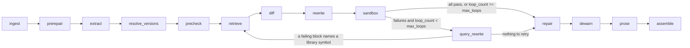

# How it works

The pipeline, its stages, the retrieval stack, the sandbox and the evidence rules.



`prerepair`, `precheck`, `repair`, `dewarn` and `prose` are opt-in stages (no-ops unless their flag
is on).

`graph.py` is a LangGraph `StateGraph` with a conditional cycle. Every node is a pure-ish function
(`GraphState` in, state patch out), typed with Pydantic, and unit-testable with a mocked LLM.

| Node | What it does |
|---|---|
| `ingest` | Lossless Markdown split into prose and code segments (re-rendering gives back the exact input), language detection, tutorial date inference, version pins from `pip install` lines |
| `extract` | AST analysis: libraries, imported/used symbols (`pandas.DataFrame.append`, `pydantic.Field(regex)`, `...Config.orm_mode`), install commands, extra third-party packages |
| `prerepair` | Opt-in. Adds imports a tutorial forgot (`np`, `pd`, `plt`, `List`, ...) before symbols are extracted, found by static analysis |
| `resolve_versions` | Old version from exact pin, then range pin, then tutorial date (never guessed); target = latest PyPI release within the migration's target major, or a user pin |
| `precheck` | Opt-in (`protect_working_blocks`). Runs the ORIGINAL tutorial in its target and old environments; blocks that already run (with unchanged output) are never edited |
| `retrieve` | Per-symbol retrieval over the corpus (see below); in loop passes it also queries with the observed error message |
| `diff` | One batched LLM call per library classifies symbols `unchanged / renamed / signature_changed / removed / behavior_changed`; every verdict must cite chunk ids actually shown to the model |
| `rewrite` | Surgical per-block LLM edits (prose is untouched unless `update_prose` is on); output must parse and every change must map to a cited verdict. Deterministic edits for install pins and newly required packages |
| `sandbox` | Builds a cached image with the exact target versions, then runs all blocks in one network-less container with per-block status, traceback, stdout and assertions |
| `query_rewrite` | Loop only: reads each failing block's traceback and names the library symbol that broke (`'DataFrame' object has no attribute 'append'` -> `pandas.DataFrame.append`, `unexpected keyword argument 'squeeze'` -> `pandas.read_csv(squeeze)`). Deterministic pattern matching, no LLM call. Only symbols still lacking evidence or a verdict are retrieved and diffed again; the diff prompt gets the observed failure. If no symbol can be named the block stays failing and ends `unresolved` |
| `repair` | Opt-in (`repair_defects`). Fixes missing packages and other defects that are not version rot, verifying each fix in the sandbox and reverting the ones that do not remove their error; drafts suggestions for undefined names |
| `dewarn` | Opt-in (`fix_warnings`). Treats a block that runs but emits a deprecation warning as a soft failure and sends it through retrieve, diff and rewrite; keeps the edit only if the block still runs with identical output, the warning is gone and no other block regressed |
| `prose` | Opt-in (`update_prose`). Sentence-level, guarded edits of text that mentions changed APIs or old versions (see Beyond version fixes) |
| `assemble` | Final Markdown + change log. Blocks still failing become `unresolved` with their last error; never reported as passing |

## Retrieval

Corpus per library from raw Markdown/RST on GitHub (migration guides, changelogs / whatsnew, docs),
chunked by section with heading path and `version_introduced` metadata. Stages, each behind a flag
in `PipelineFlags` so the eval can ablate them:

```
symbol index ─┐
BM25 ─────────┼─ RRF ─ version filter ─ cross-encoder (blended with fused score) ─ version boost ─ top-k
dense ────────┘
```

BM25 uses an identifier-aware tokenizer (`parse_obj`, `DataFrame.append` stay whole); dense uses
`BAAI/bge-small-en-v1.5` with a numpy store; reranking uses `ms-marco-MiniLM-L-6-v2`; the
symbol index maps each symbol to the changelog entries that mention it.

## Sandbox

All generated code runs only in Docker: dependencies are installed at image build time, then every
run uses `--network none`, a read-only filesystem, dropped capabilities and CPU/memory/pid/time
limits. Blocks execute in one shared namespace (tutorials are cumulative) through a driver that
`exec`s each block separately, so each gets its own result even after an earlier failure. Optional
per-block assertions (expected stdout substrings, or a snippet run in the tutorial's namespace)
make "runs without error" not the only pass criterion.

## Evidence discipline

- `DiffVerdict` and `ChangeLogEntry` reject uncited claims at the model level.
- A verdict citing ids that were never retrieved is dropped, not kept.
- `llm_prior` change entries exist only for the no-retrieval baseline and are labelled "uncited".
- A rewritten block with no attributable citation is rejected and the original kept.

## Repository layout

```
.
  pyproject.toml, uv.lock, README.md, SETUP.md
  src/trf/
    config.py        env settings, PipelineFlags, LibraryConfig registry
    llm.py           provider-agnostic wrapper (anthropic / openai-compatible / ollama), structured output, disk cache
    state.py         Pydantic models + GraphState
    graph.py         LangGraph wiring
    pypi.py          release metadata for version resolution
    nodes/           ingest, prerepair, extract, resolve_versions, precheck, retrieve, diff, rewrite,
                     sandbox, query_rewrite, repair, dewarn, prose, diagnose, assemble
    rag/             corpus, chunking, bm25, dense, hybrid (RRF), rerank, symbol_index, pipeline
    sandbox_runner/  Dockerfile + in-container runner
    eval/            dataset/ (15), dataset_heldout/ (6), dataset_libs/ (12), dataset_prose/ (9),
                     dataset_defects/ (12, generated), loader, baseline, validate_dataset, prose_check,
                     metrics, run_eval
    api/             FastAPI service + static/index.html (single-file UI)
  scripts/           retrieval_sanity.py, demo.py, check_case.py, oracle_check.py, make_defect_set.py
  tests/
```
